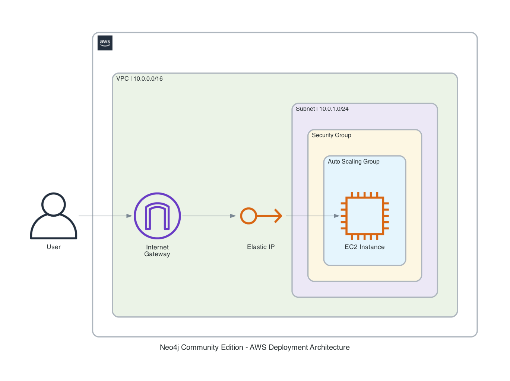

# Neo4j CE: AWS Architecture

## Core Principle: Separate Data from Compute

The single most important rule for deploying any database on AWS is: **never put database data on the OS disk**. Every AWS Marketplace database product — MongoDB, PostgreSQL, MySQL, Elasticsearch — follows this pattern. The OS root volume is ephemeral and tied to the instance lifecycle. A separate EBS data volume is a standalone resource that survives instance termination, replacement, and failure.

This template applies that principle to Neo4j Community Edition.

### What happens without a separate data volume

By default, if the database data lives on the root EBS volume and the ASG replaces the instance — whether from a health check failure or underlying hardware failure — **the data is lost**. The ASG terminates the old instance, which deletes its root volume, then launches a fresh instance from the AMI with a blank disk. The ASG has no mechanism to preserve the old root volume.

With a separate data volume, the EBS volume is a standalone CloudFormation resource that the ASG has no knowledge of and cannot delete. When the new instance boots, it attaches and mounts the existing data volume, picking up exactly where the old instance left off. Without that separation, an ASG "self-healing" a failed instance would also destroy the database it was trying to protect.

## Architecture Overview



The layout, with the data volume detail the diagram omits:

```
┌─────────────────────────────────────────────────┐
│                    VPC (10.0.0.0/16)            │
│                                                  │
│  ┌────────────────────────────────────────────┐  │
│  │         Public Subnet (10.0.1.0/24)        │  │
│  │                                             │  │
│  │  ┌──────────────────────────────────────┐   │  │
│  │  │     Auto Scaling Group (size: 1)     │   │  │
│  │  │                                      │   │  │
│  │  │  ┌────────────────────────────────┐  │   │  │
│  │  │  │        EC2 Instance            │  │   │  │
│  │  │  │                                │  │   │  │
│  │  │  │  Root EBS (OS + Neo4j binary)  │  │   │  │
│  │  │  │  /dev/xvda — destroyed with    │  │   │  │
│  │  │  │  instance                      │  │   │  │
│  │  │  └────────────────────────────────┘  │   │  │
│  │  └──────────────────────────────────────┘   │  │
│  │                    │                        │  │
│  │                    │ attached at boot       │  │
│  │                    ▼                        │  │
│  │  ┌──────────────────────────────────────┐   │  │
│  │  │   Data EBS Volume (GP3, encrypted)   │   │  │
│  │  │   /data — RETAINED on deletion       │   │  │
│  │  │   Survives instance replacement      │   │  │
│  │  └──────────────────────────────────────┘   │  │
│  │                                             │  │
│  └────────────────────────────────────────────┘  │
│                                                  │
│  ┌──────────────┐    ┌────────────────────────┐  │
│  │  Elastic IP   │    │  Internet Gateway      │  │
│  │  (stable)     │    │                        │  │
│  └──────────────┘    └────────────────────────┘  │
└─────────────────────────────────────────────────┘
```

## Why Separate the Data Volume

| Concern | Root disk | Separate EBS volume |
|---|---|---|
| Instance termination | Data lost | Data preserved |
| ASG replacement | Data lost | Volume re-attached to new instance |
| Disk sizing | Competing with OS for space | Sized independently for the database |
| Snapshots | Includes OS noise | Clean database-only backups |
| Encryption | Mixed concern | Dedicated encryption context |
| Performance tuning | Shared IOPS with OS | Dedicated IOPS for database I/O |

This is not unique to Neo4j. MongoDB, PostgreSQL, MySQL, and Elasticsearch Marketplace offerings all use the same separation. The consistent theme across all of them: **never put database data on the OS disk**.

## Key Design Decisions

### ASG of Size 1

AWS Marketplace recommends an Auto Scaling Group even for single-instance products. The ASG monitors EC2 health checks and automatically replaces a failed instance. On replacement, the new instance re-attaches the data volume and re-associates the Elastic IP, restoring service without manual intervention.

### Elastic IP

A stable public address that follows the instance across ASG replacements. Clients connect to the same IP regardless of which underlying EC2 instance is running. The EIP is associated by UserData on every boot.

### NVMe Device Resolution

Nitro-based instances expose EBS volumes as NVMe devices with non-deterministic names. The UserData script matches the EBS volume serial number against `/dev/disk/by-id/` entries to find the correct device, rather than assuming a fixed device path like `/dev/nvme1n1`.

### First-Boot-Only Formatting

The script checks for an existing filesystem with `blkid` before formatting. On first boot, the volume is blank and gets an ext4 filesystem. On subsequent boots (after ASG replacement), the existing filesystem and data are preserved.

### GP3 with Encryption

GP3 provides a baseline of 3000 IOPS and 125 MB/s throughput at lower cost than GP2. Encryption at rest is enabled by default — a baseline requirement for any database volume.

## Boot Sequence

1. Install Neo4j Community Edition from `yum.neo4j.com`
2. Wait for data volume to become available (may be detaching from a terminated instance)
3. Attach data volume to this instance
4. Resolve the NVMe device path
5. Format the volume (first boot only)
6. Mount at `/data`
7. Associate the Elastic IP
8. Install APOC plugin (if enabled)
9. Configure Neo4j (network, memory, security)
10. Set admin password (first boot only)
11. Start Neo4j
12. Signal CloudFormation success

## Reference: How Other Database Products Do It

| Product | Data volume | Resilience | Stable endpoint |
|---|---|---|---|
| Neo4j CE (this template) | Separate EBS, retained | ASG of 1 | Elastic IP |
| MongoDB Community | Separate EBS | ASG of 1 | Elastic IP |
| PostgreSQL | Separate EBS for `/var/lib/pgsql` | ASG of 1 | Elastic IP or ENI |
| MySQL | Separate EBS for `/var/lib/mysql` | ASG of 1 | Elastic IP or ENI |
| Elasticsearch | Separate EBS for data path | ASG of 1 | Elastic IP |

The implementation details vary, but the architecture is the same: compute is disposable, data is persistent, and the two are on separate volumes.
