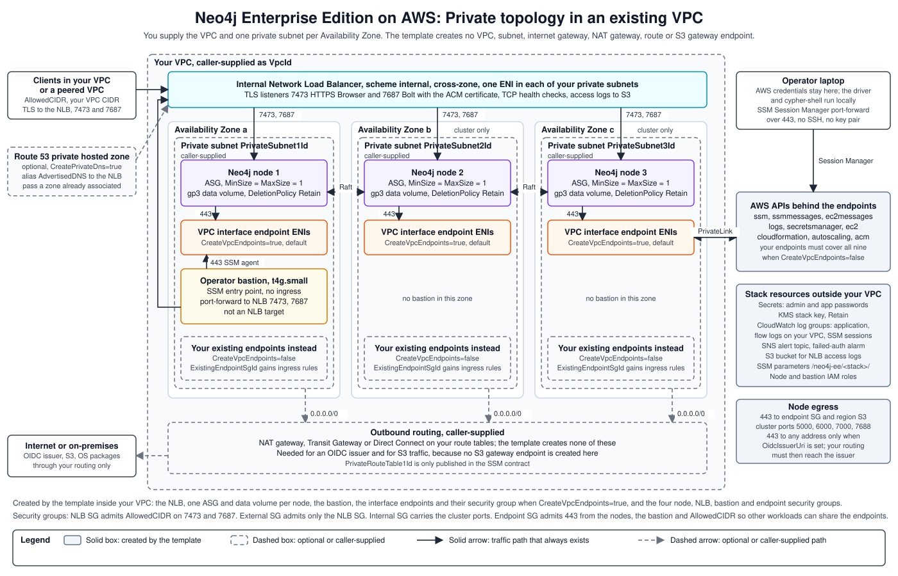

# Neo4j EE Private, Existing VPC: Architecture

## AWS Resources Created

The template creates the following inside your VPC. It does **not** create: VPC, subnets, internet gateway, or NAT Gateways. Outbound internet routing is the responsibility of the VPC you supply.

| AWS Resource | What it creates |
|---|---|
| Internal NLB | TLS listeners on port 7473 (HTTPS Browser) and 7687 (Bolt); deployed into the subnets you supply |
| EC2 instances | 1 or 3 Neo4j nodes in your private subnets; no public IPs |
| ASG per node | One Auto Scaling Group per Neo4j node, fixed at `MinSize=MaxSize=DesiredCapacity=1`, for self-healing |
| EBS data volumes | One GP3 volume per node with `DeletionPolicy: Retain`; survives stack deletion |
| Operator bastion | `t4g.small` in your private subnet, not registered as an NLB target; receives SSM sessions for operator access |
| VPC interface endpoints | `ssm`, `ssmmessages`, `ec2messages`, `logs`, `secretsmanager`, `ec2`, `cloudformation`, `autoscaling`, and `acm` with `PrivateDnsEnabled: true`. Each endpoint policy limits callers to principals in the stack account. The template creates them when `CreateVpcEndpoints=true`, which is the default, and skips them when `CreateVpcEndpoints=false` |
| Security groups | NLB SG (AllowedCIDR on 7473/7687 to the NLB); External SG (NLB SG as source on 7473/7687 to instances); Internal SG (cluster ports 5000/6000/7000/7688 between members only); Endpoint SG (gating access to the VPC endpoints) |
| SSM parameters | `/neo4j-ee/<stack>/` prefix; publishes VPC ID, NLB DNS, security group IDs, the password secret ARNs and the stack KMS key ARN |
| Secrets Manager | Neo4j admin password at `neo4j/<stack>/password` |
| CloudWatch | Log group, VPC flow logs, failed-auth alarm |

## Relationship to the Private Template

Structurally identical to `neo4j-private.template.yaml`: same operator bastion, same internal NLB, same cluster ASGs, same SSM platform contract. The only difference is that this template does not provision any VPC or networking infrastructure. It accepts `VpcId` and `PrivateSubnet1Id/2Id/3Id` and deploys into the caller-supplied network.

- **NLB hairpin fix:** The non-target bastion and `preserve_client_ip.enabled=false` apply identically. See [Operator Bastion: NLB Hairpin in the Private Architecture](../private/architecture.md#operator-bastion-nlb-hairpin)
- **Password security model:** The model is identical. It uses an alphanumeric-only `AllowedPattern`, retrieves the password from Secrets Manager at boot, and never embeds it in UserData. See [Password Security Model in the Private Architecture](../private/architecture.md#password-security-model)
- **Bolt advertised address:** This part differs from the Private template. With `CreatePrivateDns=true`, Bolt advertises `AdvertisedDNS` whether the stack creates the hosted zone or you pass one in `PrivateDnsHostedZoneId`. A zone you pass must already be associated with `VpcId`. See [NLB Routing in the Private Architecture](../private/architecture.md#nlb-routing).
- **Internet egress:** This part differs from the Private template. The Private template creates NAT gateways only when `EnableInternetEgress` is `true`. This template has no such parameter and creates no NAT gateway. Your VPC provides any outbound route, including the route to an OIDC issuer.

## VPC Interface Endpoint Design

**`CreateVpcEndpoints` parameter** (default `true`)

- **`true`, Path A:** The template creates endpoints for `ssm`, `ssmmessages`, `ec2messages`, `logs`, `secretsmanager`, `ec2`, `cloudformation`, `autoscaling`, and `acm`, plus a dedicated endpoint security group.
- **`false`, Path B:** The caller supplies an existing endpoint SG via `ExistingEndpointSgId`. A CloudFormation `Rules` block enforces this. Deployment fails at parameter validation if the value is missing.
- **Path B coverage:** The caller's endpoints must cover all nine services. Nodes have no other route to these AWS APIs, so a missing endpoint fails the node at boot.
- **Why one flag, not per-service:** enterprise VPCs that have endpoints virtually always have a single shared SG covering all nine services. Per-service flags produce half-managed states that the single `vpc-endpoint-sg-id` SSM contract parameter cannot represent

**Endpoint security group ingress**

- Both paths publish `vpc-endpoint-sg-id` to SSM, pointing at the functional endpoint SG (template-created in Path A, caller-supplied in Path B)
- Applications follow the same contract in both cases: add their SG to this SG's ingress on port 443
- Instance and bastion SGs are wired into the endpoint SG at deploy time. In Path B, the template adds `AWS::EC2::SecurityGroupIngress` rules into the pre-existing SG and removes them on stack deletion
- In Path A, the endpoint SG also allows port 443 from `AllowedCIDR`. Private DNS on these endpoints applies to the whole VPC. Every workload in your VPC that calls one of the nine services resolves it to these endpoints, so without this rule those workloads would fail.

**Node egress**

- Node security groups allow outbound traffic only to the endpoint SG on port 443, to same-region S3 on port 443, and to other cluster members on ports 5000, 6000, 7000, and 7688.
- When `OidcIssuerUri` is set, nodes also allow outbound port 443 to any address so Neo4j can fetch the identity provider's discovery document and signing keys.
- The S3 rule targets the region's AWS-managed S3 prefix list, so nodes reach only same-region S3. It keeps SSM Agent updates, patch baselines, and Hume seeding working. A Lambda-backed custom resource looks up the prefix-list ID at deploy time.
- This template creates no S3 gateway endpoint. If your VPC has one, its policy decides which buckets the nodes can read. Without one, S3 traffic leaves through your NAT route and can reach any same-region bucket.
- CloudFormation adds an allow-all egress rule to a security group whose egress list is empty. The endpoint SG therefore carries a single placeholder rule to `127.0.0.1/32` and has no other egress. The NLB SG carries the same placeholder plus egress to the instances on the Browser and Bolt ports.

## What the Caller's VPC Must Provide

| Requirement | Notes |
|---|---|
| Private subnets with outbound routing | NAT Gateway, Transit Gateway, or Direct Connect; the template provisions none of these |
| One subnet per AZ for a 3-node cluster | Each Neo4j node and its bastion are placed in the subnet passed via `PrivateSubnet1/2/3Id` |
| No duplicate interface endpoints | If `CreateVpcEndpoints=true`, the VPC must not already have endpoints for any of the nine services. Use `CreateVpcEndpoints=false` if it does |
| Matching CIDR in `AllowedCIDR` | Defaults to `10.0.0.0/16`; pass `--allowed-cidr` if your VPC uses a different range |
| A hosted zone you pass is associated with the VPC | Applies with `CreatePrivateDns=true` and `PrivateDnsHostedZoneId`. Bolt advertises `AdvertisedDNS`, so the name must resolve inside the VPC. A zone the stack creates is associated for you |

## Platform Contract

Identical to the Private template. See [Platform Contract in the Private Architecture](../private/architecture.md#platform-contract) for the full SSM parameter reference.
