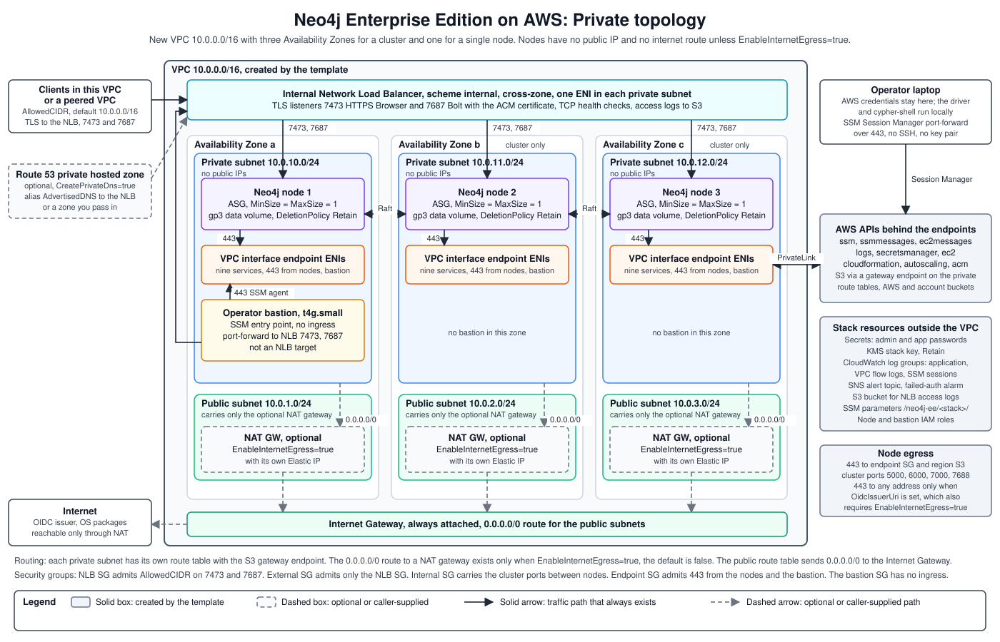

# Neo4j EE Private: Architecture



## Network Topology

**Three-node cluster:**
- VPC with three public subnets (one per AZ) for the optional NAT Gateways, and three private subnets (one per AZ) hosting the Neo4j instances
- Internal NLB with TLS listeners on 7473 (HTTPS Browser) and 7687 (Bolt), targets spread across all three private subnets
- Three Neo4j EC2 instances in private subnets, forming a Raft cluster
- Three NAT Gateways for outbound traffic from the cluster members, only when `EnableInternetEgress` is `true`
- One `t4g.small` operator bastion in a private subnet, not registered as an NLB target
- VPC interface endpoints for `ssm`, `ssmmessages`, `ec2messages`, `logs`, `secretsmanager`, `ec2`, `cloudformation`, `autoscaling`, and `acm` with `PrivateDnsEnabled: true`

**Single instance:**
- VPC with one public subnet for the optional NAT Gateway and one private subnet for the EC2 instance
- Internal NLB in the private subnet
- One NAT Gateway, only when `EnableInternetEgress` is `true`
- One `t4g.small` operator bastion

`EnableInternetEgress` defaults to `false`. Without it, the stack creates no NAT gateway and the nodes have no route out of the VPC. Set it to `true` for OIDC sign-in or for a Hume stack that shares the VPC.

The `AvailabilityZones` parameter is optional. Every deployment, including a single node, needs exactly three zones in it. A shorter list fails stack creation with an `Fn::Select` template error. Leave it blank to use the first three zones that `Fn::GetAZs` returns.

## AWS Resources Created

| AWS Resource | What it creates |
|---|---|
| VPC | New VPC with public subnets for the optional NAT Gateways and private subnets for the Neo4j instances; 3 AZs for a cluster, 1 AZ for a single instance |
| NAT Gateways | One per AZ for outbound internet access from the cluster nodes. Created only when `EnableInternetEgress` is `true` |
| Internal NLB | TLS listeners on port 7473 (HTTPS Browser) and 7687 (Bolt); routable from inside the VPC only |
| EC2 instances | 1 or 3 Neo4j nodes in private subnets; no public IPs |
| ASG per node | One Auto Scaling Group per Neo4j node, fixed at `MinSize=MaxSize=DesiredCapacity=1`, for self-healing |
| EBS data volumes | One GP3 volume per node with `DeletionPolicy: Retain`; survives stack deletion |
| Operator bastion | `t4g.small` in a private subnet, not registered as an NLB target; receives SSM sessions for operator access |
| VPC interface endpoints | `ssm`, `ssmmessages`, `ec2messages`, `logs`, `secretsmanager`, `ec2`, `cloudformation`, `autoscaling`, and `acm` with `PrivateDnsEnabled: true`. Each endpoint policy limits callers to principals in the stack account. AWS service calls need no NAT |
| Security groups | NLB SG (AllowedCIDR on 7473/7687 to the NLB); External SG (NLB SG as source on 7473/7687 to instances); Internal SG (cluster ports 5000/6000/7000/7688 between members only); Endpoint SG (gating access to the VPC endpoints) |
| SSM parameters | `/neo4j-ee/<stack>/` prefix; publishes VPC ID, NLB DNS, security group IDs, and secret ARN for downstream consumers |
| Secrets Manager | Neo4j admin password at `neo4j/<stack>/password` |
| CloudWatch | Log group, VPC flow logs, failed-auth alarm |

## NLB Routing

At boot, each cluster node sets:

```
server.bolt.advertised_address = <nlb-dns>:7687
dbms.routing.default_router    = SERVER
```

When the stack creates its own private hosted zone, the Bolt address is `<AdvertisedDNS>:7687` instead. That happens with `CreatePrivateDns=true` and an empty `PrivateDnsHostedZoneId`. The stack then owns a private record that points `AdvertisedDNS` at the NLB, and the certificate covers that name. A `neo4j+s://` driver that sends no address in its routing context still gets a name it can verify.

Every routing table entry points back to the NLB. A driver connecting with `neo4j://` receives a routing table containing only the NLB, sends all subsequent requests through it, and lets Neo4j server-side routing handle leader vs. follower direction.

- **A zone you pass in:** A zone passed in `PrivateDnsHostedZoneId` keeps Bolt on the NLB name. This template creates a new VPC, so that zone cannot already be associated with it. The Existing VPC template treats a passed zone differently. See [Private, Existing VPC Architecture](../private-existing-vpc/architecture.md#relationship-to-the-private-template).
- **Peered VPCs with private DNS:** When Bolt advertises `AdvertisedDNS`, a client in a peered VPC must be able to resolve it. Associate the private hosted zone with that VPC.
- **Turning private DNS off:** A stack update from `CreatePrivateDns=true` to `false` deletes the DNS record. Running nodes keep advertising `AdvertisedDNS` until they are replaced, so routed clients fail in the meantime. Replace the nodes one at a time right after the update. Each replacement takes about 8 minutes.
- **Your own DNS record:** A certificate passed with `--cert-arn` and a CNAME you manage outside the stack still leaves Bolt on the NLB name. A future template parameter may let Bolt advertise `AdvertisedDNS` in that case too.

| Access pattern | URI | Notes |
|---|---|---|
| Same VPC | `neo4j://<nlb-dns>:7687` | Full cluster failover |
| Peered VPC / Transit Gateway | `neo4j://<nlb-dns>:7687` | NLB DNS resolves to private IPs reachable through the peering route |
| SSM tunnel | `bolt+s://<AdvertisedDNS>:7687` | Skips routing table; reliable for operator access. Map `AdvertisedDNS` to `127.0.0.1`. Use `bolt+ssc` with the self-signed default certificate. |
| Direct node IP | `bolt://<node-ip>:7687` | Bypasses NLB; single node, no failover |

**`neo4j://` through an SSM tunnel requires a custom resolver.** Via SSM, the driver connects to `localhost:7687`. The server returns a routing table with the NLB DNS, or `AdvertisedDNS` when the stack creates its private hosted zone. The driver then tries to connect to that address, which resolves to private IPs inside the VPC. Those IPs are not reachable from the operator's laptop. Use the direct URI that `bolt-tunnel.py` prints for SSM access.

## Operator Bastion: NLB Hairpin

> **Why a dedicated bastion?** To prevent NLB hairpin failures where a cluster node tunneling SSM through itself sees its own IP as the source and silently drops the reply. One connection in three fails.

The bastion is `t4g.small`, sits in the same private subnet as the cluster, and is not registered as an NLB target.

**The failure.** When SSM tunnels ran through a Neo4j cluster member instead of a dedicated bastion, every third connection timed out. NLB target health was fine; VPC endpoints, security groups, and routing all checked out.

**Root cause.** NLB target groups default to `preserve_client_ip.enabled=true`. With preservation on, each target sees the real source IP of incoming connections. When a cluster node tunnels an SSM session outward, the source IP of each new connection is that node's own private IP. The NLB flow-hashes across the three registered targets. One time in three, the hash selects the node that originated the connection. That instance then receives a packet with source IP equal to its own IP. The kernel treats that as invalid and silently drops the reply.

**The fix.** Two layers ship together:

| Layer | Mechanism |
|---|---|
| `preserve_client_ip.enabled=false` on both NLB target groups | Each target sees the NLB ENI IP as the source. A `src == dst` collision is structurally impossible. |
| Dedicated non-target bastion | The bastion's IP is outside the NLB target pool. Hairpin cannot happen by construction. |

Either mitigation alone closes the observed failure. Both ship together so the template stays correct if a future edit changes the target-group attributes or the operator-access pattern.

**Trade-off.** With client IP preservation disabled, `security.log` on the Neo4j instances records the NLB's private ENI IP as the connection source, not the real operator IP. For an internal-only deployment, per-client attribution at the Neo4j layer is already obscured by the NLB, which is an acceptable trade-off. Customers requiring the true peer IP at the application layer can retrieve it via NLB Proxy Protocol v2.

## Platform Contract

The stack publishes resource IDs via SSM under `/neo4j-ee/<stack-name>/` so that applications and operator tooling can wire themselves up without knowing stack internals. `uv run preflight` checks the five contract parameters, `region`, `stack-name`, and the private subnet parameters on every run.

**Contract parameters:** All five are required.

| Parameter | Purpose |
|---|---|
| `/neo4j-ee/<stack>/vpc-id` | VPC the application should attach to |
| `/neo4j-ee/<stack>/nlb-dns` | Internal NLB DNS for Bolt connections |
| `/neo4j-ee/<stack>/external-sg-id` | Security group that accepts client/app ingress on 7473 and 7687 |
| `/neo4j-ee/<stack>/password-secret-arn` | Secrets Manager ARN for the Neo4j password |
| `/neo4j-ee/<stack>/vpc-endpoint-sg-id` | Security group attached to the VPC interface endpoints |

**Operational parameters:** These parameters are informational.

| Parameter | Purpose |
|---|---|
| `/neo4j-ee/<stack>/region` | AWS region |
| `/neo4j-ee/<stack>/stack-name` | Stack name |
| `/neo4j-ee/<stack>/private-subnet-1-id` | First private subnet |
| `/neo4j-ee/<stack>/private-subnet-2-id` | Second private subnet |
| `/neo4j-ee/<stack>/private-route-table-1-id` | Route table for the first private subnet |
| `/neo4j-ee/<stack>/app-password-secret-arn` | Secrets Manager ARN for the `neo4j_app` application user password |
| `/neo4j-ee/<stack>/app-username` | Application username, `neo4j_app`. The user has the built-in `architect` role. |
| `/neo4j-ee/<stack>/kms-key-arn` | Full ARN of the stack KMS key that encrypts both password secrets |
| `/neo4j-ee/<stack>/ca-pem` | PEM trust anchor for the NLB certificate. The value is `pending` until a node publishes it. See [Bolt TLS](#bolt-tls). |
| `/neo4j-ee/<stack>/advertised-dns` | DNS name that resolves to the NLB and matches the ACM certificate SAN |
| `/neo4j-ee/<stack>/bolt-url` | Bolt URL. Its scheme matches the certificate mode. |
| `/neo4j-ee/<stack>/https-url` | Neo4j Browser URL |
| `/neo4j-ee/<stack>/public-subnet-1-id` | First NAT gateway subnet, for load balancers placed in the VPC |
| `/neo4j-ee/<stack>/public-subnet-2-id` | Second NAT gateway subnet |
| `/neo4j-ee/<stack>/public-subnet-3-id` | Third NAT gateway subnet |
| `/neo4j-ee/<stack>/private-dns-hosted-zone-id` | Private hosted zone that the stack created |
| `/neo4j-ee/<stack>/private-dns-record` | Record that the stack created for the advertised name |

Some operational parameters exist only on some stacks:

- **Three-node stacks:** Only these stacks publish `private-subnet-2-id`, `public-subnet-2-id`, and `public-subnet-3-id`.
- **Private template:** Only this template publishes the `public-subnet-*` parameters. An Existing VPC stack has none.
- **Stack-created DNS:** Only a stack that creates its private hosted zone publishes `private-dns-hosted-zone-id` and `private-dns-record`.

**VPC interface endpoints.** The regional service hostnames for `ssm`, `ssmmessages`, `ec2messages`, `logs`, `secretsmanager`, `ec2`, `cloudformation`, `autoscaling`, and `acm` resolve to private IPs inside the VPC. No endpoint URL overrides are needed in application code, and no NAT data-processing charges apply to AWS service calls.

The `vpc-endpoint-sg-id` parameter is the mechanism by which applications opt into reaching these endpoints. Each application adds its own security group to the endpoint SG's ingress on port 443. Opening the endpoint SG to the whole VPC CIDR would allow any workload in the VPC to call SSM and Secrets Manager via PrivateLink. The published SG ID approach requires each application to explicitly opt in, creating an auditable per-application record and a clean removal path.

**Node egress.** The node security groups allow outbound traffic only to the endpoint SG on port 443, to same-region S3 on port 443, and to other cluster members on ports 5000, 6000, 7000, and 7688. A node has no route to the internet unless `EnableInternetEgress` is `true`. When `OidcIssuerUri` is set, the nodes also allow outbound port 443 to any address so Neo4j can fetch the identity provider's signing keys.

**S3 access from nodes.** Nodes reach only same-region S3. The S3 rule targets the region's AWS-managed S3 prefix list, so a URL for a bucket in another region fails. Traffic goes through the S3 gateway endpoint, whose policy allows only the AWS-owned package and agent buckets and buckets in the stack account. This access keeps SSM Agent updates, patch baselines, and Hume seeding from a stack-account bucket working. CloudFormation has no intrinsic that returns a prefix-list ID, so a small Lambda-backed custom resource looks it up at deploy time. The Lambda runs outside the VPC and can call only `ec2:DescribePrefixLists` and write its own log group.

**Placeholder egress rules.** CloudFormation adds an allow-all egress rule to a security group whose egress list is empty. The endpoint SG therefore carries a single placeholder egress rule to `127.0.0.1/32` and has no other egress. The NLB SG carries the same placeholder plus egress to the instances on the Browser and Bolt ports.

**Reading a password secret.** An application that reads `password-secret-arn` or `app-password-secret-arn` needs two grants. The first is `secretsmanager:GetSecretValue` on the secret. The second is `kms:Decrypt` on the key in `kms-key-arn`. Without the KMS grant, `GetSecretValue` fails with `AccessDeniedException`. The key policy allows decryption only through Secrets Manager in the stack's region.

**The stack key is single-Region and retained.** The key exists only in the stack's region. It carries `DeletionPolicy: Retain`, like both secrets, so a retained secret stays readable after the stack is deleted. `teardown.sh --delete-volumes` schedules the key for deletion with the 7-day minimum window.

See [`sample-private-app/README.md`](../../../sample-private-app/README.md) for the full application connection pattern.

## Password Security Model

- **Allowed characters:** The pattern `^[a-zA-Z0-9]{12,}$` allows only alphanumerics, 12 or more. It prevents shell metacharacter injection, such as `Test1$(cmd)` executing as root during boot.
- **Default length:** `deploy.py` generates a 32-character value
- **Storage:** Secrets Manager at `neo4j/<stack-name>/password`
- **Never in UserData:** `NoEcho: true` only suppresses values in CloudFormation API responses, not UserData. Any IAM principal with `ec2:DescribeLaunchTemplateVersions` can read UserData
- **Retrieval at boot:** Cluster nodes fetch the password with their IAM role. Its `secretsmanager:GetSecretValue` grant covers the admin and application password secrets, plus a license secret only when the matching `Install*` flag is set.

To change the `neo4j_app` password on a running stack, see the [App Password Rotation Run Book](../../run-books/app-password-rotation.md).

## Bolt TLS

The NLB terminates TLS on the Browser port (7473) and the Bolt port (7687) using the ACM certificate named by the `CertificateArn` parameter. The stack also requires `AdvertisedDNS`, and the certificate SAN and CN must both equal that name. The NLB re-encrypts traffic to the instances, which serve a self-signed certificate.

For local testing, `deploy.py` imports a self-signed ACM certificate when you pass no `--cert-arn`. Clients connect with `neo4j+ssc://`. See [TLS and DNS in the Local Testing guide](../../guides/local-testing.md#tls-and-dns).

With no `--advertised-dns`, `deploy.py` invents the name `neo4j-<stack>.neo4j.local`. The stack then creates a private hosted zone named after that name, with an alias record at the zone apex. Each stack gets its own zone, so several stacks can share one VPC. Pass `--no-create-private-dns` or `--advertised-dns` to opt out.

For production, use a stable customer-owned DNS name rather than the generated NLB DNS:

1. Obtain or import an ACM certificate whose SAN and CN are that DNS name.
2. Create a private DNS record that points the name to the internal NLB, or pass `--create-private-dns` to `deploy.py`.
3. Set `CertificateArn` and `AdvertisedDNS` as CloudFormation parameters when deploying the stack.

**Trust anchor.** Every node publishes the chain of the `CertificateArn` certificate to `/neo4j-ee/<stack>/ca-pem` before it signals CloudFormation. When ACM holds no chain, as for a self-signed import, the node publishes the certificate itself. Clients verify the NLB certificate against this value. A consumer needs `ssm:GetParameter` on the ca-pem ARN, or `ssm:GetParametersByPath` on `/neo4j-ee/<stack>/` for readers that load the whole path, no KMS. The parameter is not encrypted with the stack key.

**Consumers fail closed until the anchor is published.** The template creates the parameter with the value `pending`. A value of `pending`, or any value that does not start with `-----BEGIN CERTIFICATE-----`, means no node has published the anchor yet. A consumer must refuse to connect in that case. A stack update that changes the parameter's properties resets the value to `pending` until a node is replaced.

**Existing VPC.** Nodes read the certificate through the `acm` interface endpoint. With `CreateVpcEndpoints=false`, your endpoints must include `acm`, as [VPC Interface Endpoint Design](../private-existing-vpc/architecture.md#vpc-interface-endpoint-design) describes.

**Operator tools.** On a `neo4j+s` stack the `uv run` tools verify the NLB chain against `ca-pem`. They skip the hostname check because the SSM tunnel replaces the server name. On a `neo4j+ssc` stack they use `+ssc`. `admin-shell` uses `+ssc` on both.

**Residual risk.** Cluster-internal ports (5000, 6000, 7000, 7688) remain plaintext between cluster members, protected by the cluster security group. An actor with `ec2:RunInstances` permission to launch into the cluster subnet with the cluster security group, `ec2:CreateTrafficMirrorSession` targeting a cluster ENI, or root on any cluster node can observe replication traffic on the wire. For regulated workloads or shared-tenancy accounts where IAM blast radius extends beyond the cluster operator team, request cluster TLS before deploying.

### Certificate Rotation

TLS terminates at the NLB. A rotation changes the NLB listeners and the published anchor. The nodes keep their own self-signed certificates.

1. Import or issue the new certificate in ACM. Its SAN and CN must equal `AdvertisedDNS`.
2. Update the stack with the new `CertificateArn`. The NLB listeners serve the new certificate once the update completes. Running nodes do not republish the anchor.
3. Terminate one node. Its ASG launches a replacement, which publishes the new chain to `/neo4j-ee/<stack>/ca-pem` before it signals. One node is enough, because the NLB holds the certificate and the other nodes need no change.
4. Confirm that `ca-pem` changed. Its version increases, and its value matches the chain of the new certificate:

   ```bash
   aws ssm get-parameter --name /neo4j-ee/<stack-name>/ca-pem \
     --query 'Parameter.[Version,LastModifiedDate]' --region <region>
   ```

5. Run the release suite from `validate-private/`. Its trust anchor check completes a TLS handshake against the new `ca-pem`.
6. Retire the old certificate after every consumer has reread `ca-pem`.

> **Warning:** From the `CertificateArn` update until the replacement node publishes, `ca-pem` still holds the old chain. The stack update does not reset it to `pending`, because the parameter's properties do not change. A consumer that verifies against the old chain rejects the new certificate and fails closed. A consumer that pinned the old anchor keeps failing until it rereads `ca-pem`. Terminate the node right after the update to keep this window short.
