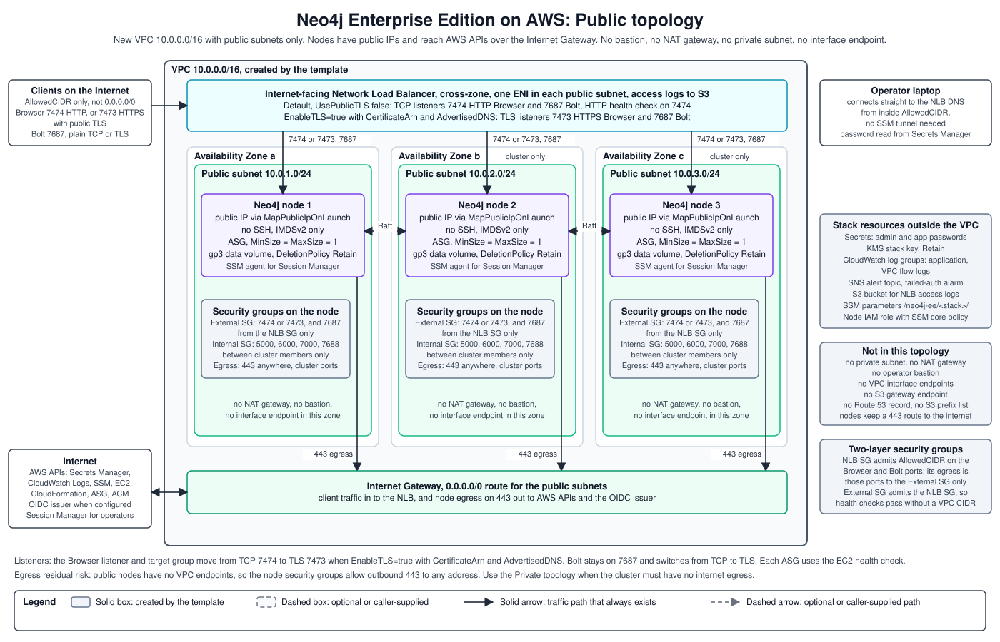

# Neo4j EE Public: Architecture

## Network Topology

Three-node cluster:
- VPC with three public subnets, one per AZ
- Internet-facing NLB distributing traffic across all three subnets
- Three EC2 instances with public IPs, no NAT Gateways, no private subnets
- Internal security group restricting cluster ports (5000, 6000, 7000, 7688) to cluster members only

Single-instance:
- VPC with one public subnet
- Internet-facing NLB in that subnet
- One EC2 instance with a public IP

The `AvailabilityZones` parameter is optional. Every deployment, including a single node, needs exactly three zones in it. A shorter list fails stack creation with an `Fn::Select` template error. Leave it blank to use the first three zones that `Fn::GetAZs` returns.

## AWS Resources Created

| AWS Resource | What it creates |
|---|---|
| VPC | New VPC with public subnets: one per AZ for a 3-node cluster, one for a single instance |
| Internet Gateway | Outbound internet access; no NAT Gateways needed |
| Internet-facing NLB | Listeners on 7474 (HTTP Browser) and 7687 (Bolt) |
| EC2 instances | 1 or 3 Neo4j nodes with public IPs; no NAT, no private subnets |
| ASG per node | One Auto Scaling Group per Neo4j node, fixed at `MinSize=MaxSize=DesiredCapacity=1`, for self-healing |
| EBS data volumes | One GP3 volume per node with `DeletionPolicy: Retain`; survives stack deletion |
| Security groups | `NLBSecurityGroup` (AllowedCIDR on Browser and Bolt ports to the NLB); `ExternalSecurityGroup` (NLBSecurityGroup as source on Browser and Bolt ports to the instances); `InternalSecurityGroup` (cluster ports 5000/6000/7000/7688 between cluster members only) |
| Secrets Manager | Neo4j admin password at `neo4j/<stack>/password` |
| CloudWatch | Log group, VPC flow logs, failed-auth alarm |

## Security Configuration

| Setting | Value | Notes |
|---|---|---|
| `AllowedCIDR` | Required | CIDR allowed to reach Browser and Bolt ports. `0.0.0.0/0` is rejected. `deploy.py` defaults to `<your-public-ip>/32`. |
| NLB security group | Filters external traffic | `AllowedCIDR` on 7474/7687 |
| Instance security group | Sources from NLB SG | Allows both forwarded client traffic and NLB health checks without hardcoding a VPC CIDR |
| IMDSv2 | Enforced | Instance metadata requires session tokens; IMDSv1 requests are rejected |
| JDWP (port 5005) | Disabled | Remote debug port is closed and the JVM debug flag is stripped from `neo4j.conf` at boot |
| TLS | Optional | Plain TCP by default, with Browser on 7474 and Bolt on 7687. `--enable-public-tls` with `--cert-arn` and `--advertised-dns` terminates TLS at the NLB, and Browser moves to 7473. |
| Node egress | HTTPS and cluster ports only | Nodes allow outbound port 443 to any address and the cluster ports 5000, 6000, 7000, and 7688 to other members. All other outbound traffic is blocked. |

## NLB Routing

At boot, each cluster node advertises the NLB DNS name for Bolt routing and keeps Neo4j Browser on HTTP port 7474. Server-side routing directs writes to the leader and reads to followers automatically.

| Access pattern | URI | Notes |
|---|---|---|
| Direct from internet | `neo4j://<NLB DNS>:7687` | No customer domain is required; use for public evaluation only. |
| Direct node IP (same subnet) | `neo4j://<node-ip>:7687` | Bypasses NLB; single node, no failover. |

Public stacks do not manage public DNS records.

## EBS Persistence

Each node has a dedicated GP3 EBS data volume. `DeletionPolicy: Retain` keeps the volume when the stack is deleted or the ASG replaces an instance. On each new instance launch, UserData resolves the correct NVMe device by matching the EBS volume serial number against `/dev/disk/by-id/nvme-Amazon_Elastic_Block_Store_*` and mounts the volume without reformatting.

## Two-Layer Security Group Design

> **Why two SGs?** NLB health checks originate from the NLB's private VPC IPs, not from `AllowedCIDR`. Applying `AllowedCIDR` directly to the instance SG blocks health checks and fails all NLB targets.

- **`Neo4jNLBSecurityGroup` (on the NLB):** allows `AllowedCIDR` on Browser/Bolt ports. It filters external client traffic without hardcoding any VPC CIDR.
- **`Neo4jExternalSecurityGroup` (on the instances):** sources from `Neo4jNLBSecurityGroup` via `SourceSecurityGroupId`. It allows both forwarded client traffic and NLB health checks.

This pattern works for any marketplace deployment without knowing the VPC CIDR at template-authoring time.

**Egress residual risk:** Public nodes have no VPC endpoints, so they reach AWS APIs over the internet. Their security groups therefore allow outbound port 443 to any address. A compromised node can still send data out over HTTPS. Use the Private template when the cluster must have no internet egress. The NLB security group allows egress only to the instances on the Browser and Bolt ports. It also carries a placeholder rule to `127.0.0.1/32`, because CloudFormation adds an allow-all egress rule when the list is empty.
